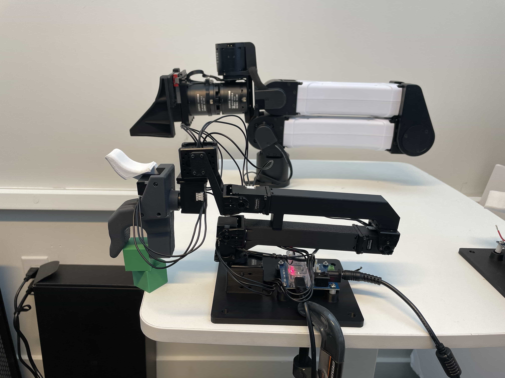

# Step 2 — Calibrate each GELLO arm

**Goal:** generate two config files per arm that map raw servo angles to YAM joint angles:

| File | Used for |
|------|----------|
| `configs/yam_auto_generated_left.yaml` / `..._right.yaml` | Real robot (Step 4) |
| `configs/yam_auto_generated_sim_left.yaml` / `..._sim_right.yaml` | MuJoCo sim (Step 3) |

Both files of a pair contain the **same GELLO calibration**. They only differ in the `robot:` block
(real YAM over CAN vs. MuJoCo).

---

## Why calibration is needed

A Dynamixel reports an absolute angle of its own horn. That number depends on how the horn happened
to be bolted on, so it isn't the robot's joint angle. Calibration finds, for each joint, the offset
such that

```
yam_joint_angle = joint_sign * (servo_angle - joint_offset)
```

reads **0 for every joint when the GELLO is in the YAM's zero pose**.

- `joint_signs` are fixed by the hardware design. For our GELLO build they are all `+1` (the default).
  The `1 -1 -1 -1 1 1` signs in upstream GELLO docs are for an **older** YAM GELLO design. Don't use them.
- Offsets are snapped to the nearest quarter turn (π/2), or 1/16 turn (π/8) for joint 1. So you only
  need to hold the pose roughly right, within ~±40° per joint. Holding it accurately still gives the
  cleanest result.

## The gripper trigger

The trigger (ID 7) is not offset-calibrated. The script reads it **once, at the moment you press Enter**:

- that reading becomes **"open"** (the gripper command = 1.0)
- "closed" (0.0) is set to 57.5° less than open

So the trigger **must be fully released (open) when you press Enter**. If it was half-squeezed, the
gripper will never fully open or close later.

---

## 2.1 Put the GELLO in the calibration (zero) pose



In this photo the GELLO (front, black) and the YAM (back) are both in the zero pose:

- base (joint 1) facing straight forward
- upper arm and forearm **folded flat and horizontal, stacked on top of each other**, pointing forward
- wrist straight, handle pointing forward, not rotated
- trigger **released**

Prop the GELLO so it holds this pose by itself. In the photo a block supports the handle. That leaves
your hands free to press Enter.

## 2.2 Run the calibration script (once per arm)

Close Dynamixel Wizard first. Then, from the repo root with the venv active, run the **left** arm
(replace the port with the left GELLO's U2D2 serial from Step 1.2, and `--channel` with your left
YAM's CAN interface name from [Step 4](04_real_robot.md#41-name-the-can-interfaces)):

```bash
python scripts/generate_yam_config.py --port=/dev/serial/by-id/usb-FTDI_USB__-__Serial_Converter_FT3M9NVB-if00-port0 --channel=can_follow_l --output-path=configs/yam_auto_generated_left.yaml --sim-output-path=configs/yam_auto_generated_sim_left.yaml
```

Then the **right** arm:

```bash
python scripts/generate_yam_config.py --port=/dev/serial/by-id/usb-FTDI_USB__-__Serial_Converter_FTAKRMFX-if00-port0 --channel=can_follow_r --output-path=configs/yam_auto_generated_right.yaml --sim-output-path=configs/yam_auto_generated_sim_right.yaml
```

The script asks you to press Enter once the GELLO is in pose, then prints:
```
   Raw Dynamixel readings (rad): [...]
Joint offsets detected successfully!
   Offsets: [2.749, 3.142, 0.000, 4.712, 6.283, 0.000]
   Gripper: open=201.9°, close=144.4°
Hardware configuration saved to: configs/yam_auto_generated_left.yaml
Simulation configuration saved to: configs/yam_auto_generated_sim_left.yaml
```

> **Always pass `--output-path`/`--sim-output-path`.** Without them, both arms write to the same
> `configs/yam_auto_generated.yaml` and the second run overwrites the first.
>
> **`--channel`** is only written into the real-robot config. If you don't have CAN names yet,
> leave it out (default `can_left`) and edit `robot.channel` in the YAML later.

## 2.3 Sanity-check the result

Open the generated YAML. It should look like this:

```yaml
robot:
  _target_: gello.robots.yam.YAMRobot
  channel: can_follow_l
  gripper_type: linear_4310
agent:
  _target_: gello.agents.gello_agent.GelloAgent
  port: /dev/serial/by-id/usb-FTDI_USB__-__Serial_Converter_FT3M9NVB-if00-port0
  dynamixel_config:
    _target_: gello.agents.gello_agent.DynamixelRobotConfig
    baudrate: 3000000
    joint_ids: [1, 2, 3, 4, 5, 6]
    joint_offsets: [2.74889, 3.14159, 0.0, 4.71239, 6.28319, 0.0]
    joint_signs: [1.0, 1.0, 1.0, 1.0, 1.0, 1.0]
    gripper_config: [7, 144.384765625, 201.884765625]
  start_joints: [0.0, 0.0, 0.0, 0.0, 0.0, 0.0, 1.0]
hz: 100
max_steps: 1000
```

Things to check:
- Every `joint_offsets` value is a multiple of π/2 ≈ 1.5708 (joint 1 may be any multiple of π/8 ≈ 0.3927).
- `gripper_config` is `[7, close_deg, open_deg]` with **open > close**, about 57.5° apart.
- `port` is the right arm's U2D2. It's easy to mix up left and right.

The real test is Step 3: if a joint moves the wrong way or is off by 90° in sim, the calibration is wrong.

## When to re-calibrate

- Any servo horn was removed/re-attached, or a servo was replaced
- A joint reads ~90° (or 180°) off in sim
- The gripper doesn't fully open/close

Re-calibrating just means re-running 2.1–2.2. It overwrites the YAMLs.

> `configs/yam_auto_generated*.yaml` are **per-GELLO and per-machine** (they contain your U2D2
> serial). They're git-ignored, so don't commit them.

Next: [Step 3 — GELLO in MuJoCo sim](03_sim.md)
